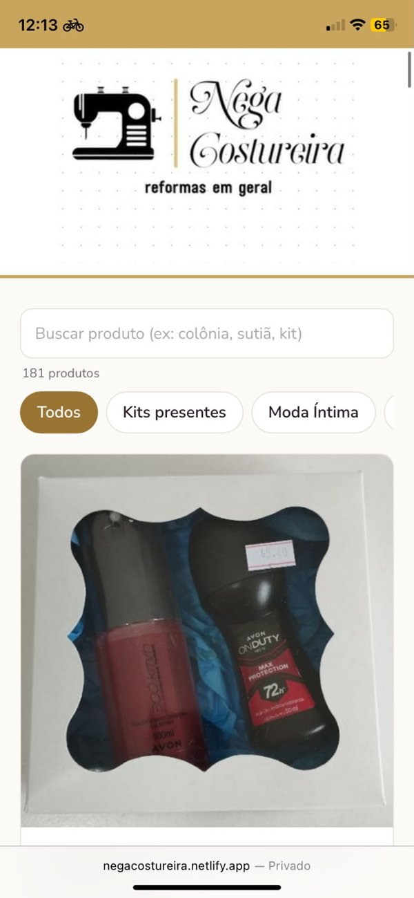
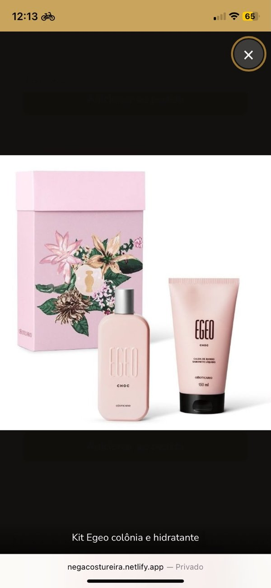
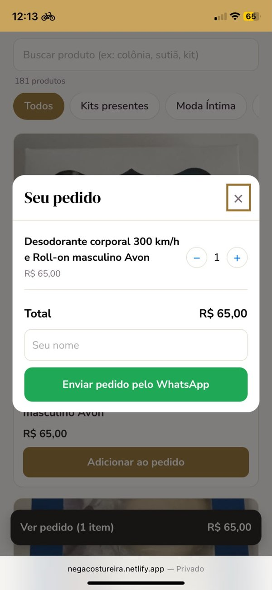
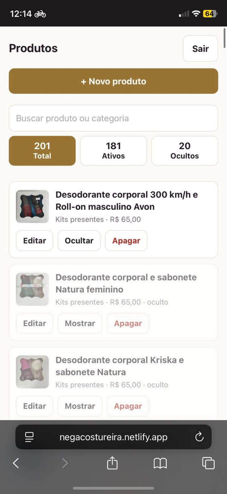

# 🧵 Nega Costureira — catálogo online

Site de catálogo e pedidos da **Nega Costureira** (Abdon Batista – SC): reformas, moda íntima, perfumes e cosméticos.
O cliente escolhe os produtos, monta o pedido e envia direto para o **WhatsApp** da loja.

🔗 **Site no ar:** https://negacostureira.netlify.app/

> Este repositório é só uma **vitrine** do projeto. O código-fonte é privado.

---

## O que o site faz

**Para o cliente**
- Catálogo com fotos, preço e tamanhos, organizado por categoria
- Busca instantânea (ignora acentos e maiúsculas)
- Várias fotos por produto, com zoom em tela cheia
- Carrinho que gera a mensagem do pedido e abre o WhatsApp da loja
- Instalável no celular (PWA) e com prévia de link no WhatsApp

**Para a loja (painel administrativo)**
- Acesso protegido por login, feito para usar pelo celular
- Cadastrar, editar, ocultar e apagar produtos
- Envio de até 6 fotos por produto, reduzidas automaticamente
- Busca e contadores de produtos ativos, ocultos e total

## Tecnologias

HTML, CSS e JavaScript puro (sem framework) · Supabase (banco de dados, autenticação e armazenamento de fotos) · Netlify (hospedagem) · PWA com service worker

## Segurança

- Permissões por linha no banco (RLS): visitantes só leem produtos ativos
- Painel com login e cadastro público desativado
- Nenhuma chave privada no código do site

## Telas

<table>
  <tr>
    <td align="center"> <b>Catálogo</b></td>
    <td align="center"> <b>Zoom da foto</b></td>
    <td align="center"> <b>Pedido</b></td>
    <td align="center"> <b>Painel da loja</b></td>
  </tr>
</table>

---

Desenvolvido por **Nilton Vezaro Junior** · [GitHub](https://github.com/niltonjr0310)
